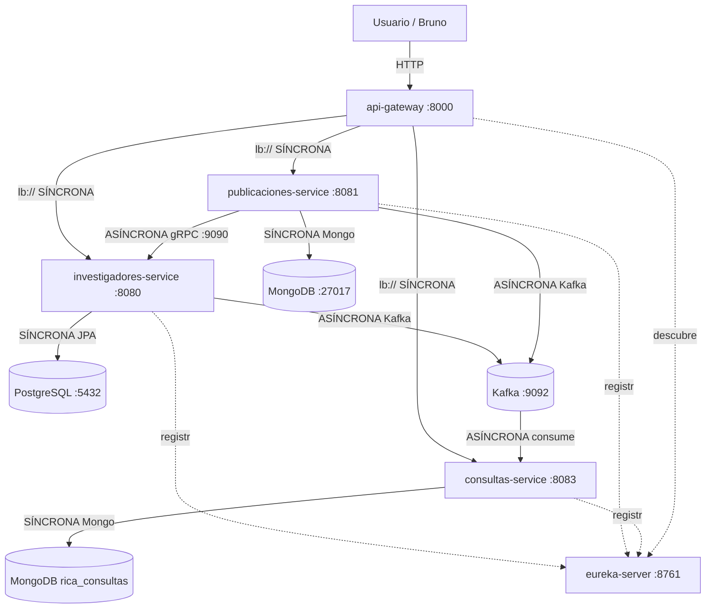

# Arquitectura de RICA

**Ingeniería de Software II · Lección 12 — Documentar la arquitectura híbrida**
**Fecha:** 2026-11-15
**Alcance documentado:** L1 a L11, tal como está construido en `main`.

---

## 1. Contexto y motivadores

RICA (Red Inteligente de Investigación y Colaboración Académica) conecta investigadores,
sus publicaciones y sus grupos, e identifica afinidades para sugerir colaboraciones. No
es un directorio: es una red dinámica de conocimiento, y su valor está en que los datos
de un investigador se crucen con los de su producción sin que el usuario note que vive
en sistemas separados.

Atributos de calidad, **ordenados** por prioridad para este sistema:

1. **Disponibilidad de la consulta** — la ficha de un investigador con sus
   publicaciones debe leerse aunque los servicios de escritura estén caídos.
   Escenario medible: con `investigadores-service` detenido, `GET
   /api/consultas/investigadores/{correo}` responde 200 en p95 < 300 ms.
2. **Consistencia eventual acotada** — al eliminar un investigador, sus publicaciones
   quedan huérfanas en ≤ 10 s o la baja se revierte. Ninguna publicación puede apuntar
   a un investigador inexistente de forma permanente.
3. **Modificabilidad del núcleo** — cambiar el mecanismo de verificación entre
   servicios (gRPC → REST → otro) toca un solo archivo y no modifica
   `PublicacionService`. Verificado por una función de aptitud.
4. **Testabilidad sin infraestructura** — los casos de uso se prueban sin Spring ni
   base de datos; el build falla si el dominio importa infraestructura.
5. **Trazabilidad de una operación** — una petición se puede seguir desde el `POST`
   hasta la proyección del evento, cruzando Kafka, con un solo identificador.

---

## 2. Estilos y patrones por componente

| Componente | Estilo / patrón | Almacén de datos | Comunicación | Atributo que sirve |
|---|---|---|---|---|
| `investigadores-service` | Hexagonal + DDD | PostgreSQL 16 (Flyway) | REST entrante; gRPC saliente no; Kafka saliente (Outbox) | Modificabilidad (1), Testabilidad (4) |
| `publicaciones-service` | Hexagonal + puerto de dominio | MongoDB 7 | REST entrante; gRPC **saliente** a investigadores; Kafka saliente | Modificabilidad (3) |
| `consultas-service` | CQRS nivel 2 (proyección) | MongoDB 7 (`rica_consultas`) | Kafka entrante; REST entrante | Disponibilidad (1) |
| `eureka-server` | Registro de servicios | — | HTTP | Descubrimiento; soporte a disponibilidad |
| `gateway` | API Gateway | — | HTTP/WebFlux, rutas `lb://` | Punto único de entrada |
| Entre `investigadores` y `publicaciones` (baja) | Saga coreografiada | Outbox en origen | **Asíncrona** (Kafka) | Consistencia (2) |
| Entre `publicaciones` y `investigadores` (validar) | Llamada RPC con Circuit Breaker | — | **Síncrona** (gRPC, deadline 5 s) | Modificabilidad (3) |
| Consumers de `consultas-service` | Consumidor idempotente + DLT + backoff | — | **Asíncrona** (Kafka) | Consistencia (2), Disponibilidad (1) |

**Prueba de necesidad, fila por fila:**

- *Hexagonal* → el dominio se prueba sin infraestructura; sin él, cada test necesitaría
  Spring y una base.
- *Microservicios por contexto* → investigadores y publicaciones tienen ciclos de vida y
  motores de datos distintos. Sin esa separación, un esquema sirve a dos usos que no se
  parecen.
- *gRPC síncrono* → la pregunta "¿existe este investigador?" se necesita **antes** de
  escribir. No se puede diferir a un evento.
- *Kafka + Outbox* → el aviso de baja no puede perderse si el bróker está caído. Sin
  Outbox, la transacción de base y la publicación divergen.
- *CQRS* → la ficha cruza dos bases. Sin modelo de lectura, una pantalla depende de dos
  servicios arriba a la vez.
- *DLT + backoff* → sin ellos, un mensaje venenoso bloquea la partición o se pierde en
  silencio.
- *Eureka + Gateway* → con cinco procesos, el cliente no puede conocer cinco puertos
  cambiantes.

**Lo que no está y por qué:** no hay service mesh (sección 6), no hay Event Sourcing, no
hay Kubernetes. Ninguno resuelve un problema de este sistema a esta escala.

---

## 3. Diagrama de contenedores (C4)



**Clasificación de cada conexión:**

| Conexión | Tipo | Por qué |
|---|---|---|
| Usuario → Gateway | Síncrona | El usuario espera respuesta |
| Gateway → servicios | Síncrona | Es enrutamiento, no propagación |
| `publicaciones` → `investigadores` (gRPC) | **Síncrona** | Es una validación previa: no se escribe la publicación si el investigador no existe |
| `investigadores` → Kafka (registro, baja) | **Asíncrona** | Es un hecho consumado; los interesados pueden enterarse después |
| `publicaciones` → Kafka | **Asíncrona** | Propaga que una publicación existe; la pantalla tolera el retardo |
| Kafka → `consultas-service` | **Asíncrona** | Proyección de lectura |
| Servicios → Eureka | Síncrona (registro) | Infraestructura, no flujo de negocio |

**Cadenas síncronas:** la más larga es `Gateway → publicaciones-service → investigadores-service`
(gRPC). Son **dos saltos**, el límite recomendado. Está protegida con deadline de 5 s y
Circuit Breaker; si `investigadores` no responde, `publicaciones` devuelve 503 en vez de
esperar. **No hay cadena de tres o más saltos**, que es el patrón de monolito distribuido
que la guía advierte.

---

## 4. Decisiones (ADR)

Los cuatro ADR viven en [`docs/adr/`](adr/) y cada uno nombra alternativa descartada y
consecuencias negativas:

| ADR | Decisión | Alternativa descartada | Costo aceptado |
|---|---|---|---|
| [`0001`](adr/0001-base-de-datos-por-servicio.md) | Una base por servicio | Base compartida | Sin integridad referencial entre servicios; dos respaldos |
| [`0002`](adr/0002-grpc-para-verificacion-sincrona.md) | gRPC con deadline y breaker | REST/JSON; consultar la base ajena | Puerto extra; no hay test automático del adaptador |
| [`0003`](adr/0003-saga-coreografiada-con-outbox.md) | Saga coreografiada + Outbox | Orquestador central; publicar sin Outbox | Estado intermedio visible; sin compensación si nadie confirma |
| [`0004`](adr/0004-cqrs-modelo-de-lectura.md) | CQRS nivel 2 para la ficha | Nivel 1; unión en el cliente | Consistencia eventual; un servicio y una base más |

Además, la Lección 7 añade el análisis de evaluación: [`docs/ATAM-LITE.md`](ATAM-LITE.md),
con el árbol de utilidad, los seis riesgos y sus decisiones.

---

## 5. Fitness functions

Dos, ambas **atómicas y disparadas** (se ejecutan en cada build):

| Función | Regla | Qué protege |
|---|---|---|
| `ArquitecturaTest` (investigadores) | El dominio y la aplicación no dependen de infraestructura | La regla del hexágono y el ADR-0001 |
| `ArquitecturaTest` (investigadores) | Los adaptadores de entrada solo hablan con aplicación o dominio | Dirección de dependencias |
| `ArquitecturaTest` (publicaciones) | `PublicacionService` no conoce `VerificadorInvestigadorGrpc` | El puerto del ADR-0002 |
| `ArquitecturaTest` (publicaciones) | Solo el adaptador habla gRPC y usa Resilience4j | El núcleo no se acopla al transporte |

En total, **seis reglas** ejecutadas por `mvnw test` y por el pipeline de GitHub Actions.

**Lo que no hay:** ninguna fitness function **continua**. No hay monitoreo de p95 ni
alertas sobre el tamaño del outbox pendiente. Se documenta como deuda.

---

## 6. Mesh: ¿lo necesitamos?

**Service mesh: no.** La justificación con números: cinco módulos desplegables, tres de
ellos con lógica de negocio, un equipo de una persona en el taller individual. Un mesh
(Istio o Linkerd) añade un proxy por pod, un plano de control y una capa que operar y
depurar; sus beneficios —mTLS uniforme, reintentos consistentes entre decenas de
servicios— no aplican a cinco procesos. Lo que la Lección 6 resolvió en código
(Resilience4j, deadline, correlation id) es la decisión proporcionada a esta escala.

**Data mesh: no.** Requiere múltiples dominios con equipos propios y un cuello de botella
real de datos analíticos. Aquí cada servicio ya es dueño de sus datos y
`consultas-service` ofrece una vista de lectura: eso cubre la necesidad de hoy. Data
mesh sería el siguiente horizonte si la facultad necesitara analítica transversal a
muchos sistemas.

Las dos respuestas siguen la regla de la guía: un mesh resuelve problemas de **escala**;
sin escala, es peso sin valor.

---

## 7. Riesgos y deuda conocida

| # | Riesgo o deuda | Impacto | Qué se haría si se materializa |
|---|---|---|---|
| **1** | **La Saga no tiene compensación.** Si `publicaciones` nunca confirma, el investigador queda `EN_ELIMINACION` para siempre. | Estado irrecuperable sin intervención manual | Añadir marca de tiempo al estado y un job que revierta a `ACTIVO` pasados N minutos |
| **2** | **La tabla de outbox no se purga.** Crece indefinidamente. | Degradación del poller a largo plazo | Trabajo programado que archive eventos publicados con más de N días |
| **3** | **`publicaciones-service` publica sin Outbox.** Escritura dual. | Si cae entre guardar y publicar, la ficha queda desactualizada sin alerta | Mover publicaciones al mismo patrón de Outbox que investigadores |
| **4** | **El consumidor de la Saga no es idempotente** (`PublicacionesMarcadasListener`). | Aceptable hoy (borrar algo ya borrado), pero el patrón no es reutilizable | Registrar `eventId` procesados antes de actuar |
| **5** | **No hay fitness function continua.** | La arquitectura evoluciona a ciegas entre commits | Exponer métricas de p95 y tamaño de outbox, con alerta |
| **6** | **El Circuit Breaker se construye a mano** en el constructor. | No se configura por propiedad | Migrar a la anotación de Resilience4j |

---

## 8. Antipatrones revisados

| Antipatrón | ¿Se cumple aquí? | Por qué |
|---|---|---|
| **Frankenstein** (un estilo por moda) | No | Cada estilo de la tabla responde a un problema nombrado en la sección 2 |
| **Monolito distribuido** | No | No hay cadena síncrona de más de dos saltos; cada servicio tiene su base |
| **Tecnología por prestigio** | No | Se descartaron mesh y Event Sourcing por escrito, y el ADR-0004 conserva la alternativa más simple |
| **Documentación que describe lo no construido** | Controlado | Lo que no existe (Kubernetes, Testcontainers, OpenTelemetry) está en la sección "Qué no se hizo" de `L9-L11.md`, marcado como tal |

---

## 9. Revisión cruzada

Pendiente de completar con el grupo asignado en la sesión del 24 de noviembre. La lista
de verificación de la guía se aplicó sobre este documento antes de entregarlo:

```
[x] Los atributos de calidad están ordenados y tienen escenario medible
[x] Cada fila de la tabla nombra el atributo que sirve
[x] No hay un estilo sin problema concreto que lo justifique
[x] El diagrama tiene flechas etiquetadas (tecnología y síncrona/asíncrona)
[x] No hay cadenas síncronas largas sin comentario
[x] Cada ADR tiene alternativa descartada y consecuencias negativas
[x] La decisión sobre mesh está justificada con números
[x] Hay al menos 2 fitness functions verificables (hay 6)
[x] Hay riesgos y deuda reconocidos (6)
[x] Una persona externa podría entender el documento en 10 minutos
```
